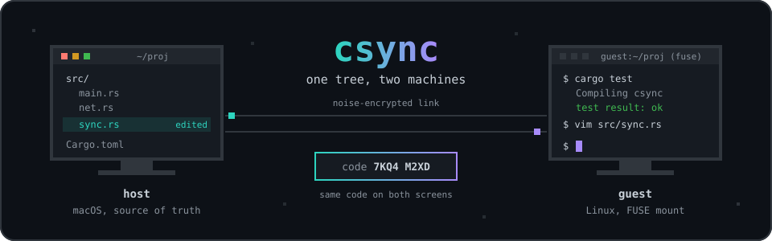
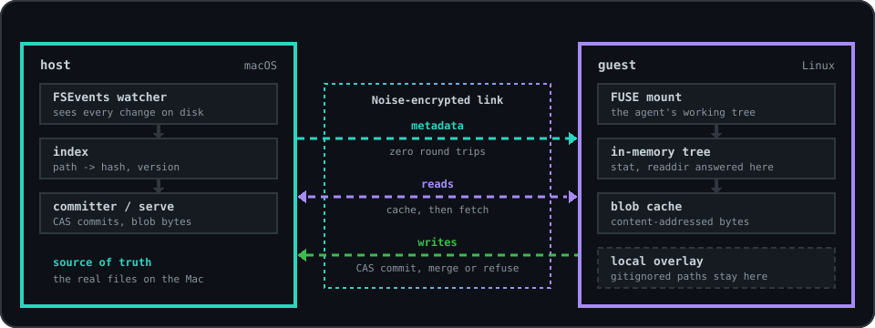
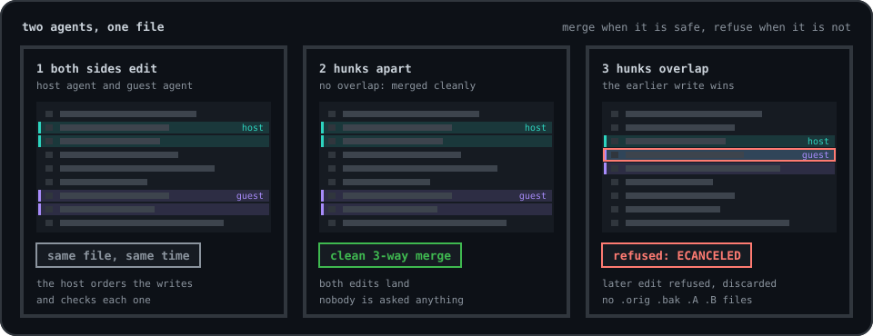
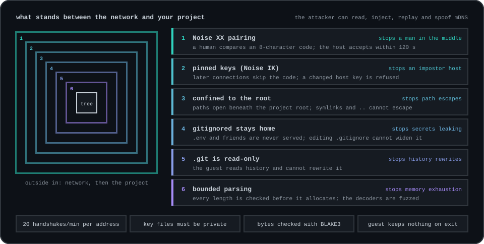

<div align="center">



**Two machines, one working tree, no pull requests.**

[](https://github.com/Seggys116/csync/actions/workflows/ci.yml)
[](https://github.com/Seggys116/csync/blob/main/LICENSE)
[](https://www.rust-lang.org)

%20%7C%20macOS%20(experimental)-30363d.svg)

[Install](#install) · [Use](#use) · [How it works](#how-it-works) · [Conflicts](#conflicts) · [Speed](#speed) · [Security](#security) · [Docs](#docs)


</div>

<br>

csync lets two coding agents work on one project at the same time: one on a Mac, one on a Linux machine. The Mac
holds the real files. The Linux machine mounts them as a normal directory, so `cargo build`, `rg`, `git status` and
editors work there without a copy that can drift. Edits from either side show up on the other side within
milliseconds, including inotify events, so file watchers keep working.

I built it to test one codebase on macOS and Linux while developing it, without a branch and a pull request for every
change.

<table>
<tr>
<td width="25%" valign="top"><b>One source of truth</b><br><sub>The host's disk is the project. The guest is a FUSE mount with a cache, not a second copy. The host tells the guest what changed.</sub></td>
<td width="25%" valign="top"><b>Gitignore is exact</b><br><sub>Ignored paths never leave the machine that made them. <code>target/</code> on the guest is a Linux build; <code>target/</code> on the Mac is a macOS build.</sub></td>
<td width="25%" valign="top"><b>Merge or refuse</b><br><sub>Non-overlapping edits merge. Overlapping ones refuse the later edit. No <code>.orig</code>, <code>.bak</code> or conflict-marker files, ever.</sub></td>
<td width="25%" valign="top"><b>Encrypted and paired</b><br><sub>Noise handshake, a short code you compare once, then pinned keys. A paired guest can touch only the synced project.</sub></td>
</tr>
</table>

## Install

**macOS and Linux**

```sh
curl -fsSL https://raw.githubusercontent.com/Seggys116/csync/main/install.sh | sh
```

The script downloads the latest release for your machine, checks its SHA-256 and installs `csync` to `~/.local/bin`
(`CSYNC_INSTALL_DIR` changes that, `CSYNC_VERSION` pins a release). Prebuilt binaries cover macOS (Apple silicon and
Intel) and Linux (x86_64 and arm64, static).

**Update**

```sh
csync update
```

This installs the latest release over the running binary with the same checks as the install script: HTTPS from the
GitHub release only, the archive verified against its published SHA-256, and the new binary run once before it replaces
the old one. `csync update --check` prints the current and latest versions and exits with 10 when an update is
available; `csync update --version X` installs a specific release, older ones included. It needs `curl` and `tar`.
Running host and join sessions keep the old version until you restart them. A binary that a package manager owns, or
in a directory you cannot write, is left alone with a message.

**From source**

```sh
cargo install --git https://github.com/Seggys116/csync
```

A Linux guest needs `fuse3` (`fusermount3`). On Debian or Ubuntu: `sudo apt install fuse3`.

A macOS guest is experimental and has not been verified against a real macFUSE mount yet. It needs macFUSE 5.5 or
later (https://macfuse.github.io) and one of two backends, tried in this order: the FSKit extension, which needs macOS
15.4 or later and must be enabled in System Settings > General > Login Items & Extensions > File System Extensions, or
the kernel extension, which must be allowed in System Settings > Privacy & Security (Reduced Security on Apple
silicon). `csync join` loads macFUSE's `libfuse3` at run time and prints what is missing if it cannot.

Run `csync doctor` on each machine to check the setup; it prints a fix for anything missing.

## Use

On the Mac, in the project:

```sh
csync host
```

On the Linux machine:

```sh
csync join
```

The guest lists the hosts it finds on the network (Bonjour). Pick one and press Enter. Both screens show the same
short code. Check that they match, press `a` on the host and `y` on the guest, and the project is mounted.

<p align="center"></p>

The code is only asked for once. After that the two machines recognise each other by key, so `csync join` mounts
straight away. Across a VPN or when mDNS is blocked, use `csync join --connect HOST:47474`. Without a terminal,
`--no-tui` prints one status line per event and takes commands on stdin, which is what scripts and agents use.

<p align="center"></p>

<p align="center"></p>

<p align="center"></p>

The screens above are captures of a macOS host and a Linux guest running against each other. The interface animates
only while something is changing and stops all timers when the terminal loses focus, so an idle `csync` costs nothing.

Both screens list recent changes in an Activity panel. Select a row with the arrow keys or the mouse and press Enter,
or click it again, to see a diff of that change. A guest diffs the version before the change against the one after it; the host, which
keeps no history, compares the working tree against git HEAD and labels it that way.

## How it works

<p align="center"></p>

The host runs one file-system watcher on the project root (FSEvents on macOS, inotify on Linux) and keeps an index of
every synced file. The guest receives that index when it joins, so `stat`, `readdir` and `git status` are answered
from memory without a network round trip. File contents are fetched on first read, checked against their hash and
kept in an on-disk cache. When a file changes on the host, the host pushes an invalidation, and the guest drops the
stale data and raises the matching inotify event. Paths that gitignore excludes live in a plain directory on the
guest's own disk and never cross the link. Neither the cache nor that directory outlives the session: quitting the
guest unmounts and then deletes both, so every join starts from a fresh snapshot of the host and a file the host
deleted on purpose can never come back. Pairing is not affected.

`.git` is read-only on the guest: you can run `git log`, `git diff` and `git status` there, but only the host changes
history. `git status` on the guest is fast with no extra git settings.

## Conflicts

<p align="center"></p>

Every write is a compare-and-swap against the version the writer started from. If the file moved on, the guest
fetches the new version, runs a three-way merge, and tries again. If the merge is clean, both edits land. If it is
not, the later edit is refused: the writing program gets `ECANCELED`, the guest shows the host's content again, and
nothing else is written anywhere. Editors that save through a temporary file and a rename are handled the same way.

## Speed

<p align="center"></p>

Measured end to end by the `bench` workflow (`scripts/bench-e2e.sh`): a real host and a real FUSE guest in one container on a GitHub-hosted runner, over loopback, on a checkout of 15,959 files (the source of csync's own dependencies). Medians of three runs, with the fastest and slowest shown as whiskers. "Native" is the same command run directly on the host's directory. Every join starts with an empty cache, so "first run" is what a new session sees and "repeat" is a repeat inside the same session.

The runner is a small shared machine and the host, the guest and the background hasher all run on its few cores, so the first-run numbers swing from run to run (the first `find` took between 321 and 1,033 ms). Real networks add their round-trip time to the first reads of uncached files. Writing a large file to the host is the slowest path here, at about 65 MiB/s against about 700 MiB/s for reading one.

A 30,000-file write storm inside an ignored `target/` directory costs the host 0 ms of CPU on Linux. On macOS the host uses a single FSEvents stream on the project root with the usual build directories excluded; with a project open, `fseventsd` uses about the same CPU as it would without csync. `csync bench` runs the micro-benchmarks.

## Security

<p align="center"></p>

Connections use the Noise protocol (X25519, ChaCha20-Poly1305, BLAKE2s). First contact is a Noise XX handshake
that you confirm by comparing a short code on both screens; later connections use the pinned keys. A paired guest can
read and write the synced project and nothing else: paths are opened relative to the project root without following
symlinks, gitignored files are never served, `.git` is read-only, and every length in the protocol is bounded before
anything is allocated. A guest cannot widen what is synced by editing a `.gitignore`. Details and the threat model are
in [SECURITY.md](SECURITY.md). Report problems privately through GitHub security advisories.

## Limits

- The guest runs on Linux, and experimentally on macOS through macFUSE 5.5 or later; the macOS guest has not been
  verified against a real mount, and everything measured here is from a Linux guest. A Linux host works, mainly so the
  tests can run host and guest on one machine.
- One project per `csync host` process.
- Paths deeper than 128 directories, and symlinks that would point outside the project root, are refused.
- Kernel passthrough, used for ignored files and for synced files while a guest writes them, needs `CAP_SYS_ADMIN`
  and a supporting file system; without it, their data goes through the daemon.
- In the synced tree a hard link becomes an independent copy, extended attributes are not supported on the guest,
  and `flock` and `fcntl` locks are not shared with the host. FIFOs and sockets can live only in ignored directories.
- Writes need the host to be reachable. Cached files stay readable if the link drops, and uncommitted guest writes
  are retried when it comes back.
- Nothing is kept between guest sessions. Quitting deletes the blob cache and the ignored-path overlay (build
  outputs, `node_modules`, virtual environments), so the next join downloads the project again and rebuilds them. A
  guest that was killed or lost power is cleaned up the next time it joins that host.

## Docs

[How it works](docs/how-it-works.md) · [Configuration and commands](docs/configuration.md) · [Contributing](CONTRIBUTING.md) · [Security](SECURITY.md) · [Changelog](CHANGELOG.md)

<br>

<p align="center"><sub>MIT licensed &middot; &copy; 2026 Zak Noble-Clarke</sub></p>

<div align="center">

<a href="https://www.buymeacoffee.com/seggy116"></a>

</div>
